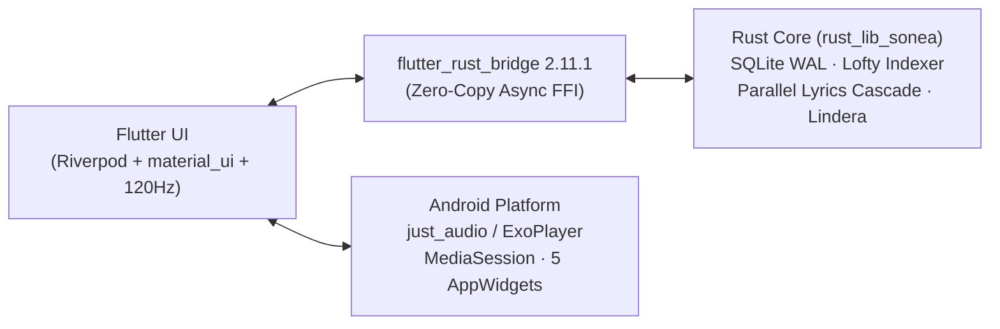
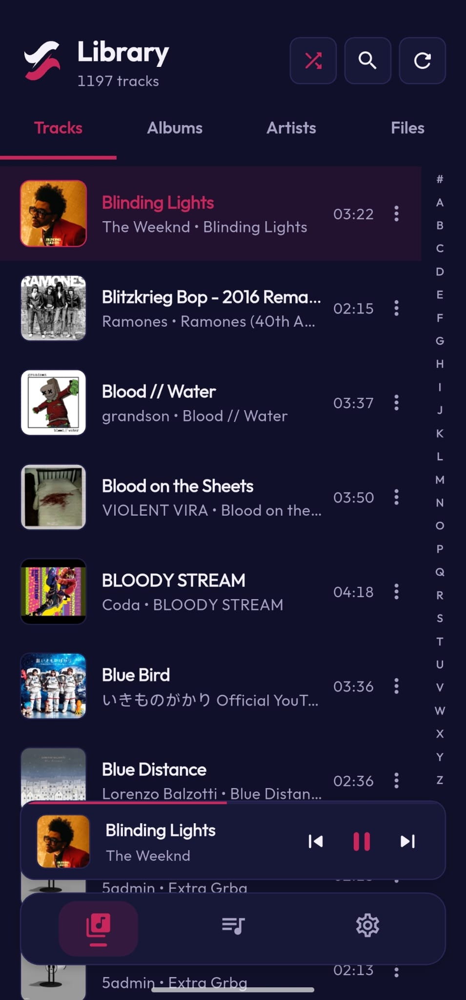
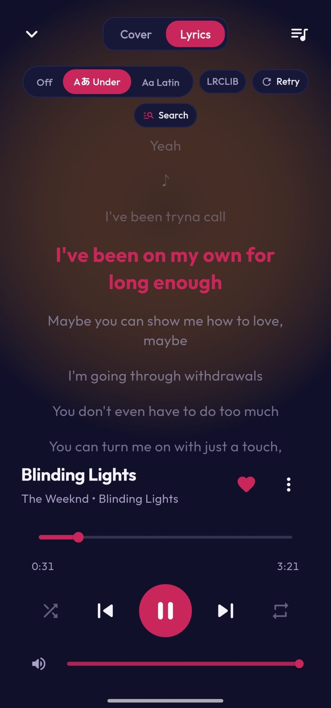

<div align="center">


# Sonea

**Minimalist, 120Hz-fluid, ad-free, offline-first audiophile music player for Android built with Flutter & Rust.**

[](https://github.com/BoynuzluKitsune/Sonea/releases/latest)
[](LICENSE)
[](https://github.com/BoynuzluKitsune/Sonea/releases/latest)
[](https://flutter.dev)
[](https://www.rust-lang.org)
[](https://github.com/BoynuzluKitsune/Sonea/actions/workflows/ci.yml)

<br />

[-78C7C7?style=for-the-badge&logo=android&logoColor=0B0C0E)](https://github.com/BoynuzluKitsune/Sonea/releases/latest)

<br />

[Features](#features) · [Sanzo Wada Themes](#sanzo-wada-themes) · [Architecture](#architecture) · [Screenshots](#screenshots) · [Build](#build-from-source) · [🇹🇷 Türkçe](#turkce)

</div>

---

<a id="features"></a>
## ✨ Core Pillars

### 🎤 6-Provider Synced-First Karaoke Lyrics & Offline Romaji
- **Parallel 3-Stage Fetch Cascade (`std::thread::scope`):** Local-first resolution (SQLite cache → sidecar `.lrc`/`.txt` → embedded tags → `0ms` local instrumental heuristic), followed by a ~200ms `LRCLIB` exact fast-path, then a **concurrent race** across **LRCLIB**, **KuGou**, **NetEase Cloud Music**, and **Musixmatch**, falling back in parallel to **Genius** and **Lyrics.ovh** only if all synced sources miss. Plain text **never** blocks verified time-synced karaoke `.lrc`.
- **Zero-False-Positive Matching Gates:** Enforces strict artist similarity (CJK/Romaji transliteration-aware), exact normalized matching for short titles, duration sanity checks, and timestamp-vs-duration verification — preferring `None` over attaching the wrong song's lyrics.
- **Instrumental Track Detection:** Instant metadata & classical-form heuristics plus provider-confirmed instrumental flags (`LRCLIB`, `NetEase`, `KuGou`) render a calm **Instrumental Track** view instead of empty errors, while skipping instrumental tracks during bulk downloads.
- **5-Worker Parallel Bulk Downloader:** Concurrent worker pool with connection pooling and per-provider atomic HTTP `429` cooldowns, plus **Manual Candidate Search**, **Paste / Edit Lyrics**, and safe **Clear Auto-Fetched Cache** (preserving manual lyrics).
- **100% Offline Pure-Rust Transliteration:** Lazy-loaded `lindera` (IPADIC) + `wana_kana` for **Japanese Kanji/Kana → Romaji**, plus **Korean Hangul**, **Cyrillic**, **Greek**, and **Chinese Pinyin** — switchable live between `Off`, `Under`, and `Latin` modes.

### 🎧 Audiophile Playback Engine
- **Gapless High-Resolution Playback:** Seamless zero-gap album transitions powered by `just_audio` (ExoPlayer) and `audio_service` with full Android `MediaSession` & Bluetooth metadata support.
- **5-Band Hardware Equalizer:** Real-time band gains and presets integrated directly into the audio pipeline.
- **ReplayGain Normalization:** `Track` and `Album` modes with Pre-Amp gain and Anti-Clipping protection.
- **Thoughtful Playback Controls:** Fade-out **Sleep Timer**, drag-to-reorder **Queue**, waveform or thin-line **Seekbar**, dynamic ambient cover glow, and configurable skip intervals & playback speed.

### 📂 Folder-First Library & 2×2 Auto-Collage Playlists
- **Fast Native Rust Indexer:** Multi-threaded incremental scanner (`lofty` + WAL-mode bundled `rusqlite`) streaming live progress across `FLAC`, `OPUS`, `MP3`, `M4A`, `AAC`, `OGG`, `WAV`, `AIFF`, and `WV` with SHA-256 deduplicated artwork caching and memory-bounded decoding.
- **Effortless Browsing:** Dedicated **Tracks**, **Albums**, **Artists**, and **Files (Folders)** tabs with short-audio duration filter (`30s` default to hide voice notes & ringtones), folder exclusion blacklist, `# A–Z` fast alphabet scroller, Turkish/Unicode-normalized instant search, and multi-select batch actions.
- **Rich Playlists & Backups:** Smart Playlists (*Favorites*, *Recently Played*, *Most Played*), custom user playlists with automatic **2×2 artwork collages** or custom cover overrides, `.m3u8`/`.pls`/`.xspf`/`.csv` import & `.m3u8` export, and schema-validated JSON backup/restore.

### 🧩 5 Theme-Synced Android Home Screen Widgets
Every native widget adapts automatically to your active **Sanzo Wada** color plate and **Light / Dark** mode:

| Widget | Grid Size | Highlights |
| :--- | :---: | :--- |
| **Cover Tile** | `2×2` | Artwork-first square tile with translucent scrim controls & quick launch |
| **Micro Pill** | `4×1` | Compact floating capsule with cover art, animated waveform, and transport controls |
| **Quick Mix Dock** | `4×2` | One-tap *Shuffle All* card, Play/Pause, and 3 quick playlist launchers |
| **Studio Card** | `4×2` | Large cover art, audio format badge (`FLAC` / `OPUS` / `MP3`), live wave, shuffle & transport |
| **Up Next Desk** | `4×3` | Full playback header paired with the next 3 tappable queue tracks |

> **Privacy & Security by Design:** Zero ads, zero analytics, zero tracking, `usesCleartextTraffic="false"` (`rustls-tls` HTTPS-only), RFC-3986 host allowlists, 100% parameterized SQLite queries, and `allowBackup="false"`.

---

<a id="sanzo-wada-themes"></a>
## 🎨 Sanzo Wada 10-Theme Collection

All 10 themes are curated from Sanzo Wada's *A Dictionary of Color Combinations* (*Haishoku Soukan*, 1933–34). Every plate ships handcrafted **Dark & Light** modes (`System | Light | Dark`), WCAG AA contrast, bespoke typography pairings, and a dedicated **Theme Gallery**.

| Plate | Theme | Typography Pairing | 4-Color Palette |
| :---: | :--- | :--- | :--- |
| `No. 255` | **Kuro & Asagi** *(Default)* | `Plus Jakarta Sans` |     |
| `No. 340` | **Taisho Avant-Garde** | `Space Grotesk` + `Inter` |     |
| `No. 303` | **Showa Studio** | `IBM Plex Sans` |     |
| `No. 288` | **Kenpou Vinyl** | `Newsreader` + `Inter` |     |
| `No. 331` | **Kachi Indigo** | `Outfit` |     |
| `No. 271` | **Tetsu Jade** | `DM Sans` |     |
| `No. 329` | **Kakitsubata Dusk** | `Fraunces` + `Inter` |     |
| `No. 263` | **Kuriume Ceramic** | `Manrope` |     |
| `No. 348` | **Haishoku Finale** | `Playfair Display` + `Inter` |     |
| `No. 343` | **Shiracha Editorial** | `Lora` + `IBM Plex Sans` |     |

---

<a id="architecture"></a>
## 🏗️ Architecture



---

<a id="screenshots"></a>
## 📸 Screenshots

<div align="center">
<table>
  <tr>
    <td align="center"></td>
    <td align="center"></td>
    <td align="center"></td>
    <td align="center"></td>
  </tr>
  <tr>
    <td align="center"><sub><strong>Library</strong></sub></td>
    <td align="center"><sub><strong>Now Playing</strong></sub></td>
    <td align="center"><sub><strong>Synced Karaoke Lyrics</strong></sub></td>
    <td align="center"><sub><strong>Sanzo Wada Themes</strong></sub></td>
  </tr>
</table>
</div>

---

<a id="build-from-source"></a>
<details>
<summary><strong>🛠️ Build from Source &amp; Development</strong></summary>

### Prerequisites
- **Flutter SDK** (`>= 3.29`) & Dart SDK (`^3.14.0`)
- **Rust toolchain** (`stable`) with Android target (`rustup target add aarch64-linux-android`)
- **Android SDK** (`compileSdk 36`, `minSdk 26`) & **NDK** (`28.2.13676358`)
- **`flutter_rust_bridge_codegen` `2.11.1`** *(only needed when editing Rust `pub fn` signatures)*

### Commands

```bash
# 1. Install Dart dependencies
flutter pub get

# 2. Regenerate FRB bindings (only after changing Rust FFI signatures)
flutter_rust_bridge_codegen generate

# 3. Run Rust unit tests & strict Clippy checks
cargo clippy --manifest-path rust/Cargo.toml --all-targets -- -D warnings
cargo test --manifest-path rust/Cargo.toml

# 4. Run Flutter static analysis & widget/unit tests
flutter analyze
flutter test

# 5. Build signed release APK (ARM64 or split-per-abi)
flutter build apk --release --target-platform android-arm64
# or:
flutter build apk --release --split-per-abi
```

### Release Signing (Optional)
Create a gitignored `android/key.properties` file pointing to your keystore (if omitted, Gradle falls back cleanly to debug signing):

```properties
storePassword=YOUR_STORE_PASSWORD
keyPassword=YOUR_KEY_PASSWORD
keyAlias=sonea
storeFile=sonea-release.jks
```

Compiled APKs are written to `build/app/outputs/flutter-apk/`.

</details>

<a id="turkce"></a>
<details>
<summary><strong>🇹🇷 Türkçe Tanıtım &amp; Özellikler</strong></summary>

### Sonea Nedir?
**Sonea**, akıcı 120Hz Flutter arayüzünü (`package:material_ui` + Riverpod) yerel olarak derlenmiş Rust çekirdeği (`rust_lib_sonea` / `flutter_rust_bridge 2.11.1`) ile birleştiren; **reklamsız, takipçisiz ve tamamen çevrimdışı odaklı** bir Android odyofil müzik çalardır.

### Öne Çıkan Özellikler
- **6 Sağlayıcılı Paralel Senkronize Karaoke Şarkı Sözü & Çevrimdışı Romaji:** Önce yerel kaynaklar (SQLite önbelleği → yan `.lrc`/`.txt` → gömülü etiketler → `0ms` enstrümantal algılama), ardından `LRCLIB` hızlı eşleşmesi ve `std::thread::scope` ile **LRCLIB**, **KuGou**, **NetEase** ve **Musixmatch** üzerinde paralel senkronize arama (yedek olarak **Genius** ve **Lyrics.ovh**). Katı sanatçı/kısa başlık/süre doğrulama kapıları sayesinde yanlış şarkı sözü eşleşmesini önler; **Enstrümantal Parça** ekranı, 5 işçili paralel toplu indirme, **Manuel Söz Arama**, **Söz Yapıştır / Düzenle** ve `lindera` + `wana_kana` ile tamamen çevrimdışı Japonca/Korece/Kiril/Çince transliterasyon sunar.
- **10 Çift Modlu Sanzo Wada 4-Renkli Tema Koleksiyonu:** Sanzo Wada'nın *Haishoku Soukan* (1933–34) renk arşivinden seçilen **Kuro & Asagi** (*No. 255*), **Taisho Avangart** (*No. 340*), **Showa Stüdyo** (*No. 303*), **Kenpou Plak** (*No. 288*), **Kachi Çivit** (*No. 331*), **Tetsu Yeşim** (*No. 271*), **Kakitsubata Alacası** (*No. 329*), **Kuriume Seramik** (*No. 263*), **Haishoku Final** (*No. 348*) ve **Shiracha Editoryal** (*No. 343*) paletleri — her biri bağımsız `Sistem | Aydınlık | Karanlık` modu, WCAG AA kontrastı ve özel tipografi eşleşmesiyle gelir.
- **Odyofil Oynatma Motoru:** Boşluksuz (gapless) geçiş (`just_audio` + `audio_service`), 5-Bant Donanım Ekolayzırı, ReplayGain (`Şarkı` / `Albüm` + ön-amfi + bozulma önleme), kademeli kısılan Uyku Zamanlayıcısı, sürükle-bırak Oynatma Sırası ve dalga formu / ince çizgi ilerleme çubuğu.
- **Klasör Odaklı Kütüphane ve 2×2 Kolaj Çalma Listeleri:** Çok iş parçacıklı `lofty` + WAL SQLite tarayıcısı (`FLAC`, `OPUS`, `MP3`, `M4A`, `AAC`, `OGG`, `WAV`, `AIFF`, `WV`), kısa ses filtresi (`30 sn`), klasör kara listesi, `# A–Z` hızlı harf kaydırıcısı, çoklu seçim, otomatik 2×2 kapak kolajı veya özel kapaklı listeler, `.m3u8`/`.pls`/`.xspf` içe-dışa aktarma ve doğrulamalı JSON yedekleme.
- **Tema ile Senkronize 5 Yerel Android Widget'ı:** *Cover Tile (`2×2`)*, *Micro Pill (`4×1`)*, *Quick Mix Dock (`4×2`)*, *Studio Card (`4×2`)* ve *Up Next Desk (`4×3`)* — aktif Sanzo Wada paletine ve Aydınlık/Karanlık moduna otomatik uyum sağlar.

### Kaynaktan Derleme
```bash
flutter pub get
cargo clippy --manifest-path rust/Cargo.toml --all-targets -- -D warnings
cargo test --manifest-path rust/Cargo.toml
flutter analyze && flutter test
flutter build apk --release --target-platform android-arm64
```

</details>

---

## 📄 License & Acknowledgments

- **License:** **Sonea** is free and open-source software licensed under the **GNU General Public License v3.0 (GPL-3.0)** — see [LICENSE](LICENSE). Third-party notices and bundled fonts are documented in [THIRD_PARTY_LICENSES.md](THIRD_PARTY_LICENSES.md).
- **Color Theory:** Inspired by Sanzo Wada's *A Dictionary of Color Combinations* (*Haishoku Soukan*, 1933–34).
- **Open-Source Foundations:** Built on [Flutter](https://flutter.dev), [Rust](https://www.rust-lang.org), [flutter_rust_bridge](https://github.com/fzyzcjy/flutter_rust_bridge), [just_audio](https://github.com/ryanheise/just_audio), [audio_service](https://github.com/ryanheise/audio_service), [lofty](https://github.com/Serial-ATA/lofty-rs), [rusqlite](https://github.com/rusqlite/rusqlite), [lindera](https://github.com/lindera/lindera), and [wana_kana](https://github.com/PSeitz/wana_kana_rust).
- **Lyrics Providers:** Powered by public metadata from LRCLIB, KuGou, NetEase Cloud Music, Musixmatch, Genius, and Lyrics.ovh.
