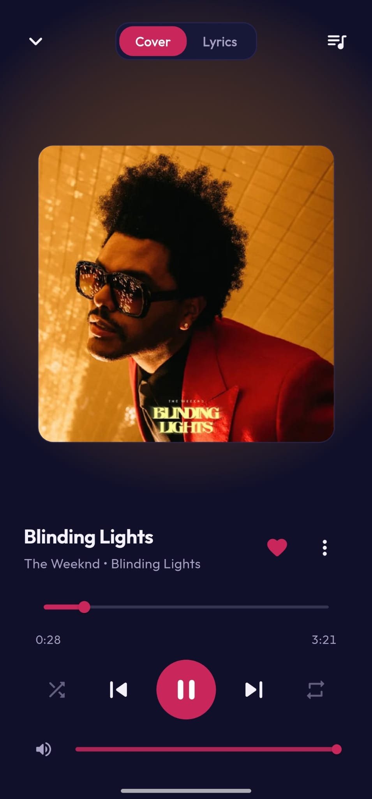
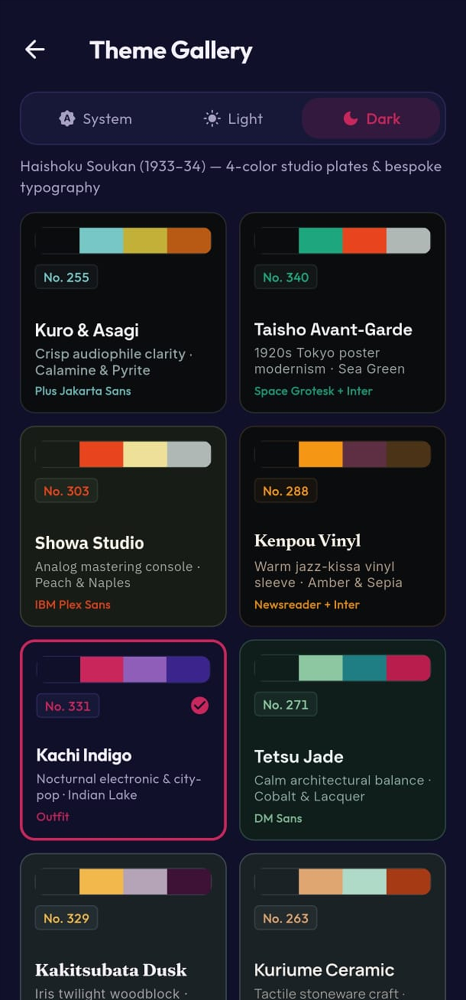

<div align="center">


# Sonea

An offline-first Android music player built with Flutter and Rust.

[](https://github.com/BoynuzluKitsune/Sonea/releases/latest)
[](LICENSE)
[](https://github.com/BoynuzluKitsune/Sonea/releases/latest)
[](https://github.com/BoynuzluKitsune/Sonea/actions/workflows/ci.yml)

<br />

**[Download latest APK](https://github.com/BoynuzluKitsune/Sonea/releases/latest)** · [Features](#features) · [Themes](#themes) · [Build](#build-from-source) · [Türkçe](#turkce)

</div>

<br />

<div align="center">
<table>
  <tr>
    <td align="center"></td>
    <td align="center"></td>
    <td align="center"></td>
    <td align="center"></td>
  </tr>
  <tr>
    <td align="center"><sub>Library</sub></td>
    <td align="center"><sub>Now Playing</sub></td>
    <td align="center"><sub>Synced Lyrics</sub></td>
    <td align="center"><sub>Themes</sub></td>
  </tr>
</table>
</div>

## Features

- Local library with folder browsing, short-audio filtering, `# A–Z` fast scroller, and 2×2 playlist covers
- Gapless playback, 5-band equalizer, ReplayGain (`Track` / `Album`), and sleep timer
- Time-synced karaoke lyrics (local `.lrc`/embedded tags, parallel multi-source lookup, instrumental detection, manual search/paste) and offline Rust transliteration for Japanese, Korean, and Cyrillic
- 10 dual-mode (Light/Dark) themes based on Sanzo Wada's *A Dictionary of Color Combinations*
- 5 theme-synced Android home screen widgets (`Cover Tile`, `Micro Pill`, `Quick Mix Dock`, `Studio Card`, `Up Next Desk`)
- No ads, no telemetry, HTTPS-only network calls

## Themes

All 10 palettes include both Light and Dark modes (`System | Light | Dark`).

| Plate | Name | Font | Colors |
| :---: | :--- | :--- | :--- |
| `No. 255` | Kuro & Asagi | Plus Jakarta Sans |     |
| `No. 340` | Taisho Avant-Garde | Space Grotesk + Inter |     |
| `No. 303` | Showa Studio | IBM Plex Sans |     |
| `No. 288` | Kenpou Vinyl | Newsreader + Inter |     |
| `No. 331` | Kachi Indigo | Outfit |     |
| `No. 271` | Tetsu Jade | DM Sans |     |
| `No. 329` | Kakitsubata Dusk | Fraunces + Inter |     |
| `No. 263` | Kuriume Ceramic | Manrope |     |
| `No. 348` | Haishoku Finale | Playfair Display + Inter |     |
| `No. 343` | Shiracha Editorial | Lora + IBM Plex Sans |     |

## Architecture

```text
Flutter UI (Riverpod, material_ui)
  ├── flutter_rust_bridge 2.11.1 ──▶ Rust core (SQLite WAL, lofty indexer, parallel lyrics, lindera)
  └── Android platform           ──▶ just_audio / ExoPlayer, MediaSession, 5 AppWidgets
```

<a id="build-from-source"></a>
<details>
<summary><strong>Build from source</strong></summary>

Requirements: Flutter SDK (`>= 3.29`), Rust (`stable` + `aarch64-linux-android`), Android SDK (`compileSdk 36`, `minSdk 26`), NDK `28.2.13676358`.

```bash
flutter pub get
cargo clippy --manifest-path rust/Cargo.toml --all-targets -- -D warnings
cargo test --manifest-path rust/Cargo.toml
flutter analyze
flutter test
flutter build apk --release --target-platform android-arm64
```

If you change exported Rust FFI signatures, regenerate bindings with `flutter_rust_bridge_codegen generate` (`2.11.1`).

For signed release builds, add a gitignored `android/key.properties` file (`storePassword`, `keyPassword`, `keyAlias`, `storeFile`). If absent, Gradle falls back to debug signing.

</details>

<a id="turkce"></a>
<details>
<summary><strong>Türkçe özet</strong></summary>

**Sonea**, Flutter ve Rust ile geliştirilmiş, çevrimdışı odaklı bir Android müzik çalardır.

- Klasör tarayıcılı yerel kütüphane, kısa ses filtresi, `# A–Z` hızlı kaydırıcı ve 2×2 kolajlı çalma listeleri
- Boşluksuz (gapless) oynatma, 5 bant ekolayzır, ReplayGain (`Şarkı` / `Albüm`) ve uyku zamanlayıcısı
- Zaman senkronize karaoke şarkı sözleri (yerel `.lrc`/gömülü etiketler, paralel çok kaynaklı arama, enstrümantal parça algılama, elle arama/yapıştırma) ve çevrimdışı Rust Japonca/Korece/Kiril transliterasyonu
- Sanzo Wada'nın *A Dictionary of Color Combinations* (1933–34) eserinden uyarlanmış 10 çift modlu (Aydınlık/Karanlık) tema
- Aktif temayla uyumlu 5 Android ana ekran widget'ı (`Cover Tile`, `Micro Pill`, `Quick Mix Dock`, `Studio Card`, `Up Next Desk`)
- Reklamsız, takipçisiz, yalnızca HTTPS ağ çağrıları

</details>

## License

Licensed under [GPL-3.0](LICENSE). Third-party licenses are listed in [THIRD_PARTY_LICENSES.md](THIRD_PARTY_LICENSES.md).

Color palettes adapted from Sanzo Wada's *Haishoku Soukan* (1933–34). Built with Flutter, Rust, `flutter_rust_bridge`, `just_audio`, `lofty`, `rusqlite`, `lindera`, and `wana_kana`.
